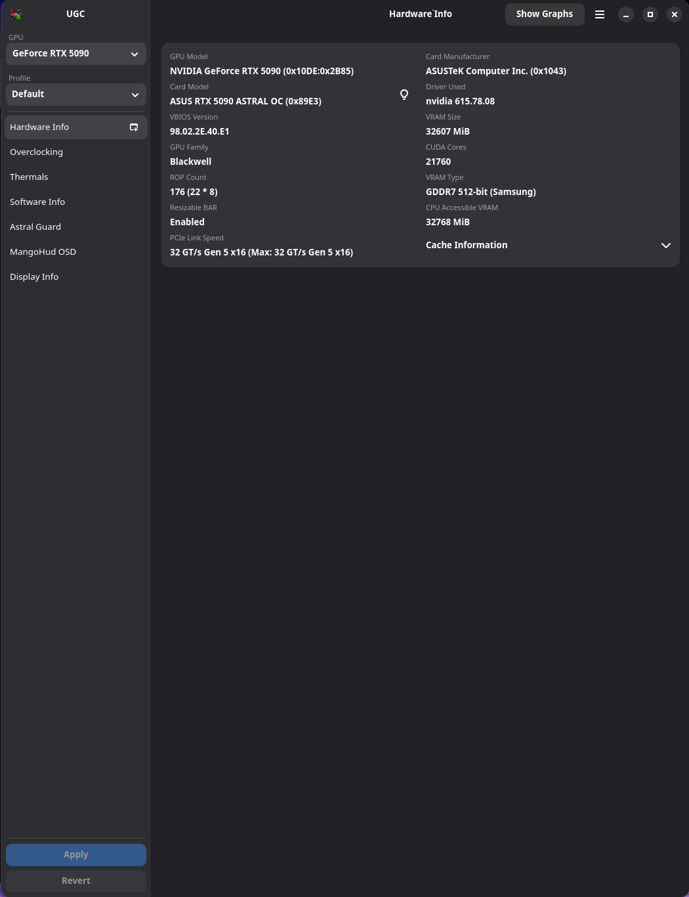
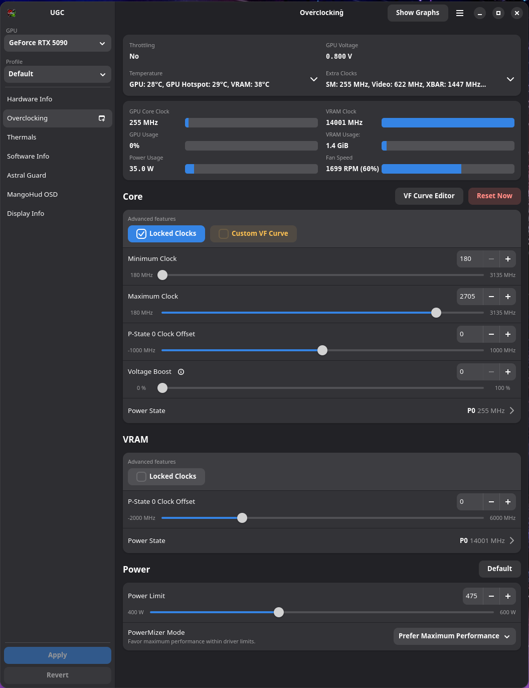
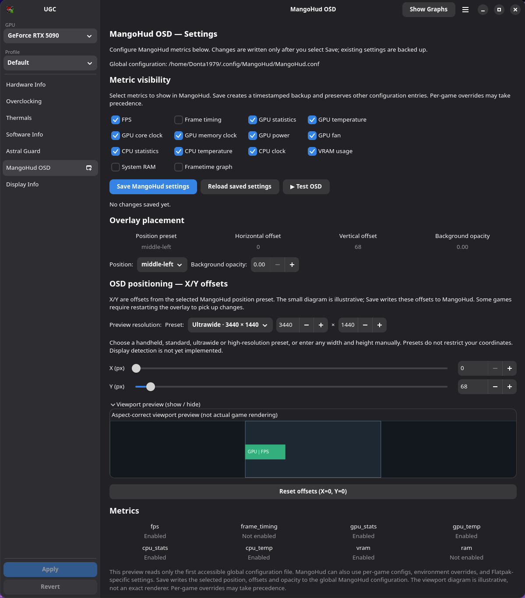
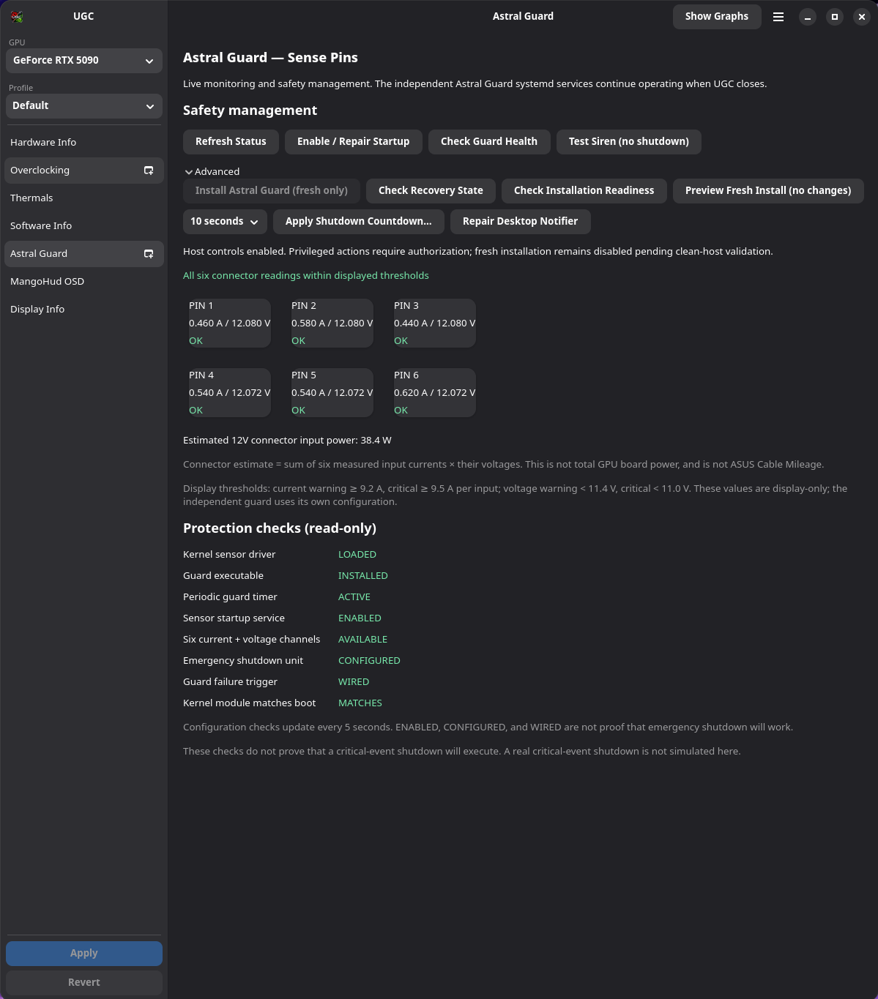
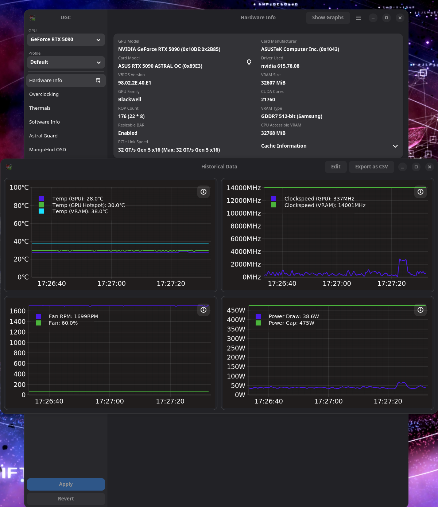
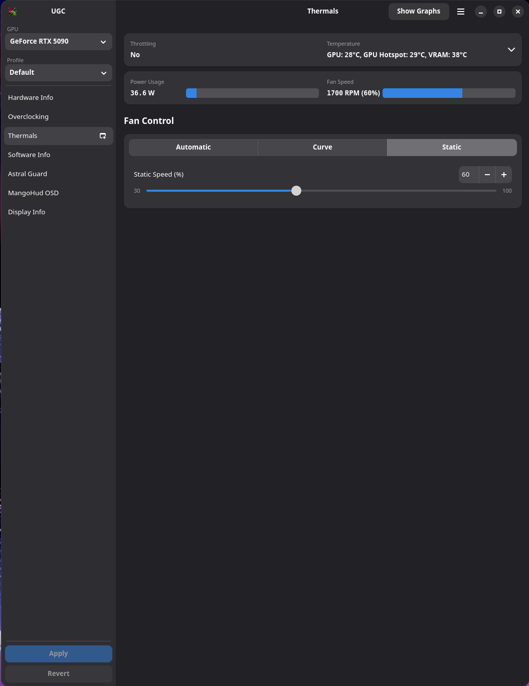
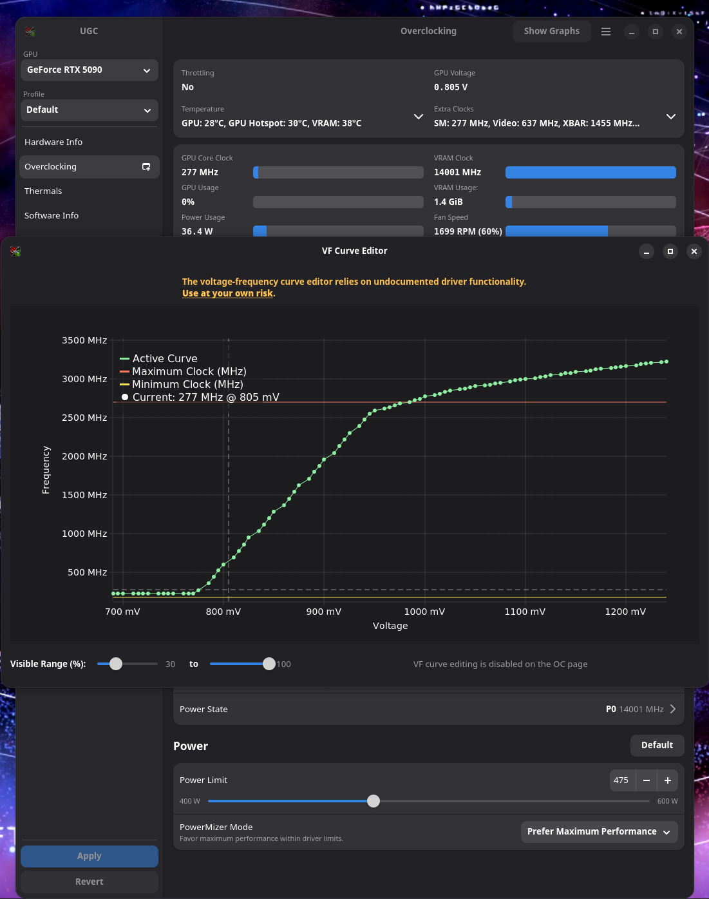
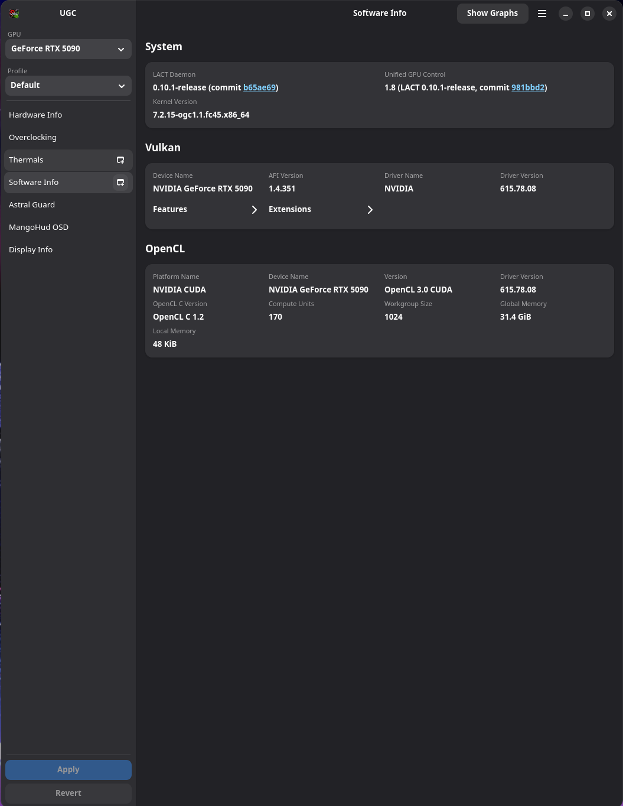
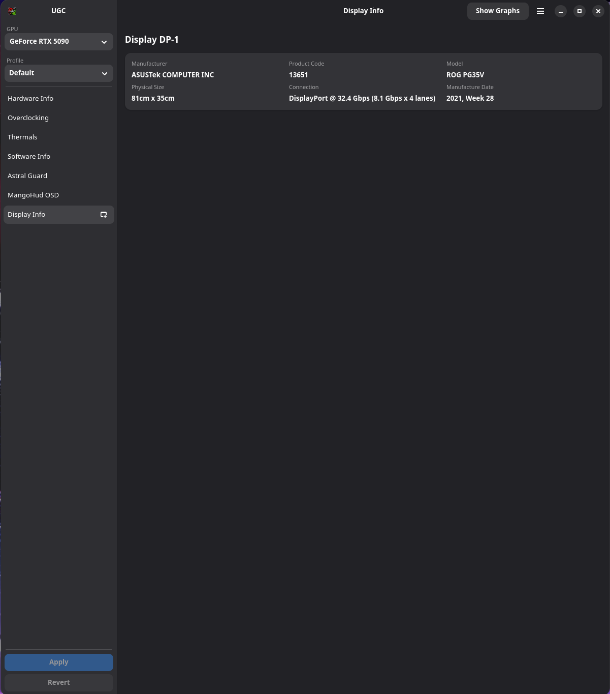

# Unified GPU Control (UGC) v1.8

**GPU management, monitoring, and supported hardware protection in one Linux application.**

Unified GPU Control brings together three useful tools in a single graphical interface:

- **LACT** — GPU information, monitoring, performance tuning, and fan controls.
- **MangoHud** — In-game performance overlay configuration.
- **ASUS ROG Astral Guard / Sense Pin** — Compatible GPU power connector monitoring and independent emergency protection integration.

UGC is an independent, community-developed application built upon the open-source LACT project.

## Screenshots

### Hardware Information


### GPU Overclocking


### MangoHud Configuration


### ASUS ROG Astral Guard


<details>
<summary><strong>Additional screenshots — click to expand</strong></summary>

### Historical Graphs


### Thermals


### Voltage/Frequency Curve Editor


### Software Information


### Display Information


</details>

## Features

### GPU Management — LACT
- GPU hardware and software information.
- GPU performance monitoring and historical graphs.
- Supported GPU clock, power, voltage, and fan controls.
- Voltage/frequency curve editing where supported.

Available controls depend on the GPU, driver, and LACT daemon.

### MangoHud
- Graphical configuration for supported MangoHud options.
- Convenient access to in-game monitoring settings.

MangoHud must be installed and available to the system.

### ASUS ROG Astral Guard / Sense Pin
- Power connector monitoring on compatible ASUS ROG Astral hardware.
- Per-pin current and voltage readings when supported.
- Visibility into driver, sensor, and guard service status.
- Integration with independently running Astral Guard protection.

**Important:** UGC is not a substitute for the independent emergency shutdown service. Always verify that Astral Guard is operational outside the graphical application.

### Additional Functionality
- Settings export and import.
- Linux Flatpak packaging.
- UGC application branding and desktop launcher.

## Installation

UGC v1.8 is being prepared as a Linux x86_64 release.

1. Download the release archive from the GitHub Releases page when available.
2. Extract the archive.
3. Open a terminal in the extracted directory.
4. Run:

```bash
./install.sh
```

Follow the installer prompts.

The installer handles the UGC Flatpak installation and checks for an existing installation. Some supporting components may require additional installation or authorization.

**Release candidate status:** Installation detection and identical-version handling have been tested on Bazzite. Fresh installations, upgrades, and missing-dependency scenarios still require validation before a final stable release.

## Requirements

- Linux x86_64.
- Flatpak.
- A supported AMD or NVIDIA GPU and compatible drivers for the desired controls.
- LACT daemon for GPU management.
- MangoHud for its corresponding features.

The ASUS ROG Astral Guard integration is optional and requires compatible hardware and its supporting driver and protection services.

UGC was developed and tested primarily on Bazzite Linux with KDE. Other Linux distributions and desktop environments may require additional testing.

## Why I Created UGC

My background is in AAA game development, where I worked as an environment artist and 3D modeler. While working with Autodesk Maya, I used MEL and some Python to build small tools that simplified repetitive tasks and improved my workflow.

After moving to Linux and choosing Bazzite, I found myself dealing with a different kind of workflow problem.

I wanted to monitor and protect my ASUS ROG Astral graphics card without constantly relying on terminal commands. After operating system updates disrupted parts of my Astral Guard setup, I wanted a simple graphical way to check whether the driver and emergency protection services were actually running.

That started as a small Astral Guard management interface.

From there, I wanted to bring together the GPU controls I already used through LACT, MangoHud configuration, and Astral Guard monitoring into one application.

That became **Unified GPU Control**.

My goal is to make these tools more accessible to Linux users, especially people who want powerful GPU controls without needing to become Linux administrators just to use them.

UGC is a free, open-source project built on the work of other developers.

## Project Status

**Version:** 1.8 release candidate

The current focus is final installation validation, packaging verification, documentation, and release preparation.

Some hardware-specific features require compatible devices and supporting software. Features shown in screenshots may not be available on every system.

## Credits and Attribution

UGC builds upon existing open-source projects and components.

- **LACT**, originally developed by Ilya Zlobintsev: https://github.com/ilya-zlobintsev/LACT
- **MangoHud**: https://github.com/flightlessmango/MangoHud
- **Astral Guard / Astral hardware monitoring:** Integration with the corresponding hardware monitoring and protection components.

UGC is an independent derivative of LACT and is not an official LACT release.

The original LACT license and copyright notice are preserved in `LICENSE`. The original project README is retained in `docs/LACT-Original-README.md`.

The respective upstream projects retain their own authorship, licenses, and trademarks.

## Hardware Safety

GPU tuning and power-related changes can affect system stability and hardware operation.

UGC displays information from supporting tools and services but cannot guarantee protection against hardware faults.

For ASUS ROG Astral systems, the independent Astral Guard service and emergency shutdown mechanism must be installed, enabled, and verified separately. Closing UGC must not be relied upon to start or maintain those protections.

## Contributing

Bug reports, reproducible issues, suggestions, and pull requests are welcome.

Please include your Linux distribution, GPU, driver version, and relevant logs when reporting technical issues.
